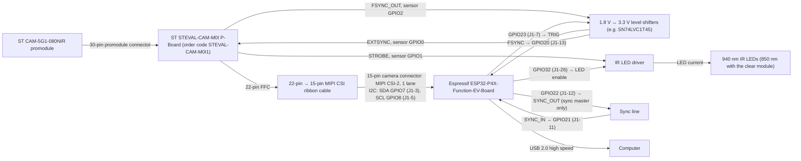

# nir-eye-cam

[](https://github.com/olinesn/nir-eye-cam/actions/workflows/firmware.yml)
[](https://github.com/olinesn/nir-eye-cam/actions/workflows/host.yml)
[](https://github.com/olinesn/nir-eye-cam/actions/workflows/pre-commit.yml)
[](LICENSE)
[](.github/CODEOWNERS)

Small near-infrared cameras for mouse pupil and eye imaging. Each camera is
an ST VD55G1 global-shutter monochrome sensor on an ESP32-P4, which streams
8-bit frames to the computer over USB 2.0 high speed. Several cameras record
to one timeline through a shared sync wire, and the sensor's external-sync
input should let every camera start its exposure on the same pulse (not yet
verified on hardware). The original, simpler build, a Himax HM01B0 (Arducam's
Pico module) on a Seeed XIAO RP2040 or Raspberry Pi Pico, speaks the same
protocol and works with the same host tools.

```
firmware-p4/  ESP32-P4 firmware (ESP-IDF, C) for the VD55G1 build: MIPI CSI-2
            capture, frame and sync timestamps, external sync, IR strobe,
            USB 2.0 high-speed streaming (compiles; not yet run)
host/       Python: nireyecam-record, nireyecam-align, nireyecam-list,
            nireyecam-bench, nireyecam-sensortest, plus a simulated camera
            for testing without hardware
docs/       vd55g1-esp32p4.md (the ESP32-P4 build), vd55g1-fpdlink.md (a
            serializer head for freely moving animals), wiring.yml (the
            parts and wiring drawn below), hardware.md (illumination and
            safety, sync, tether, depth, and the RP2040 build), protocol.md,
            and the dual-colour miniscope (miniscope.md, sensor-bench-test.md)
firmware/   RP2040 firmware for the original HM01B0 build (Pico SDK, C)
common/     nec_protocol.h, the packet format both firmwares share
```

Read [docs/vd55g1-esp32p4.md](docs/vd55g1-esp32p4.md) first for the
ESP32-P4 build (parts, optics, sync, bring-up plan), and
[docs/hardware.md](docs/hardware.md) for illumination and safety. The
RP2040 build is in hardware.md too: its cameras are **time-aligned, not
exposure-synchronized**, since the Arducam module has no trigger input.

## Status

- **ESP32-P4 firmware:** compiles with ESP-IDF v6.1 and esp_tinyusb 2.4 with
  no warnings, and its pin map is set for the ESP32-P4X-Function-EV-Board,
  but it has **not yet run on hardware**. The first checks, in
  [firmware-p4/README.md](firmware-p4/README.md)'s order: the P-Board
  (lane polarity, the cable, power enable), then the sensor's boot and model
  ID, RAW8 frames over CSI, USB high-speed throughput, frame timestamps, and
  external sync. `nireyecam-bench` runs most of them.
- **Host software:** tested against the simulator (`pytest` in `host/`):
  protocol, command replies, recording, and alignment against ground truth
  with clock drift and a missed sync pulse.
- **RP2040 firmware (original build):** compiles with no warnings
  (`-Wall -Wextra`, Pico SDK 2.3.1, Arm GNU Toolchain 14.3.rel1) for both
  boards, but has **not yet run on hardware**. Expect first-bring-up fixes. Points to check on the bench:
  - the measured frame rate (it depends on the module's oscillator);
  - USB throughput at 160×120;
  - the analog-gain register bits (`0x0205[6:4]`, from the Himax register
    description);
  - that VSYNC timestamps fire while the PIO reads the same pin.

## Parts and wiring

The recommended parts for the ESP32-P4 build, and how they connect. The
diagram is drawn from [docs/wiring.yml](docs/wiring.yml) and from the pins the
firmware defines (`firmware-p4/main/board.h`), so it changes when those do.
Details and alternatives are in
[docs/vd55g1-esp32p4.md](docs/vd55g1-esp32p4.md). The original low-cost
build, an Arducam HM01B0 on a Raspberry Pi Pico or XIAO RP2040, is in
[docs/hardware.md](docs/hardware.md).

<!-- wiring:begin -->
<!-- Generated by scripts/wiring.py from docs/wiring.yml and the firmware's pin headers. Edit those, then run: python3 scripts/wiring.py -->

### ESP32-P4 build: ST VD55G1 + ESP32-P4X-Function-EV-Board

Global shutter, and exposure-locked sync through EXTSYNC. Nothing here has run on hardware yet: check the P-Board items in firmware-p4/README.md before first power-up.



| Part | Notes |
|---|---|
| **ST CAM-5G1-080NIR promodule** | VD55G1, 804 × 704 mono global shutter, 80° lens with a 940 nm bandpass filter. For 850 nm light: CAM-5G1-081CLR plus an 830 nm long-pass filter. CAM-5G1-160CLR (160° fisheye) is for bring-up only. |
| **ST STEVAL-CAM-M0I P-Board (order code STEVAL-CAM-M0I1)** | 30-pin promodule input, 22-pin FFC output, its own 12 MHz clock for the sensor. |
| **22-pin → 15-pin MIPI CSI ribbon cable** | Check the P-Board's pinout and lane polarity first; the ESP32-P4 cannot swap a lane's P and N. |
| **Espressif ESP32-P4X-Function-EV-Board** | Chip revision v3.1+ (what the firmware builds for). Firmware `nir-eye-cam-…-esp32p4.zip`. |
| **1.8 V ↔ 3.3 V level shifters (e.g. SN74LVC1T45)** | The sensor's GPIOs run at 1.8 V. |
| **IR LED driver** | Lights the LEDs only while the sensor's STROBE and the board's LED enable are both high. Circuit still to be designed; its MOSFET must switch fully at 1.8 V. |
| **940 nm IR LEDs (850 nm with the clear module)** | Current set by a resistor. |
| **Sync line** | The rig's TTL, or the master's SYNC_OUT; also every camera's trigger in exposure-locked mode. |
| **Computer** | On the Type-C port labelled USB 2.0. Flash through the one labelled USB Serial/JTAG. |
| **Close-up lens f ≈ 15 mm in a 3D-printed cap** | Frames the eye; see docs/vd55g1-esp32p4.md (Optics). |

<!-- wiring:end -->

## Build the firmware

GitHub Actions builds both firmwares on every push or pull request that
touches them ([.github/workflows/firmware.yml](.github/workflows/firmware.yml)),
fails on any compiler warning, and attaches the `.bin` / `.uf2` files to the
run as artifacts. To build locally:

### ESP32-P4

With ESP-IDF v6.1 installed
([Espressif's guide](https://docs.espressif.com/projects/esp-idf/en/stable/esp32p4/get-started/)):

```bash
cd firmware-p4 && . ~/esp/esp-idf/export.sh
idf.py set-target esp32p4
idf.py build        # -> build/nir_eye_cam_p4.bin, with the bootloader and partition table
```

[firmware-p4/README.md](firmware-p4/README.md) has the rest: the board, its
pin map and wiring, and what to check before first power-up.

### RP2040 (original build)

One-time setup (what this repo was built with): CMake and Ninja from
Homebrew, Arm's GNU toolchain for macOS (the full one with newlib, unpacked
to `~/pico/toolchain`), and the Pico SDK.

```bash
brew install cmake ninja
mkdir -p ~/pico/toolchain && cd ~/pico
curl -LO https://developer.arm.com/-/media/Files/downloads/gnu/14.3.rel1/binrel/arm-gnu-toolchain-14.3.rel1-darwin-arm64-arm-none-eabi.tar.xz
tar -xJf arm-gnu-toolchain-14.3.rel1-darwin-arm64-arm-none-eabi.tar.xz -C toolchain
git clone --depth 1 --branch 2.3.1 --recurse-submodules --shallow-submodules https://github.com/raspberrypi/pico-sdk
```

Build (one folder per board):

```bash
export PICO_SDK_PATH=~/pico/pico-sdk
export PICO_TOOLCHAIN_PATH=~/pico/toolchain/arm-gnu-toolchain-14.3.rel1-darwin-arm64-arm-none-eabi
cd firmware
cmake -B build-xiao -G Ninja -DNEC_BOARD=xiao -DPICOTOOL_FETCH_FROM_GIT_PATH=$HOME/pico/picotool
cmake --build build-xiao        # -> build-xiao/nir_eye_cam_xiao.uf2
```

Use `-DNEC_BOARD=pico` (and `build-pico`) for a Raspberry Pi Pico. The SDK
downloads and builds `picotool` (its UF2 tool) on first use;
`PICOTOOL_FETCH_FROM_GIT_PATH` keeps one shared copy.

## Flash the firmware

Use the files you built, or download them from the latest successful CI run
on `main` (GitHub keeps them for 90 days):

```bash
run=$(gh run list -R olinesn/nir-eye-cam -w firmware.yml -b main -s success -L 1 --json databaseId -q '.[0].databaseId')
gh run download "$run" -R olinesn/nir-eye-cam -n nir-eye-cam-esp32p4 -D fw-esp32p4
```

For the RP2040 boards use `-n nir-eye-cam-xiao -D fw-xiao` or
`-n nir-eye-cam-pico -D fw-pico`. Each release also attaches these files
(`nir-eye-cam-vX.Y.Z-esp32p4.zip`, and the two `.uf2`).

### ESP32-P4: esptool

The ESP32-P4X-Function-EV-Board has three Type-C ports. Flash through the
one labelled **USB Serial/JTAG**, which also carries the logs; the camera
streams frames on the one labelled **USB 2.0**, the high-speed port. Other
ESP32-P4 boards have the same pair: a UART or USB Serial/JTAG port for
flashing, and the high-speed OTG port. To find the flashing port's name,
compare `ls /dev/cu.*` before and after plugging it in: USB Serial/JTAG shows
up as `/dev/cu.usbmodem…`, a USB-to-UART bridge as `/dev/cu.usbserial-…`.

From your own build (ESP-IDF loaded):

```bash
cd firmware-p4 && . ~/esp/esp-idf/export.sh
idf.py -p /dev/cu.usbmodemXXXX flash monitor   # Ctrl-] leaves the monitor
```

From a CI download (no ESP-IDF needed: `uvx` runs esptool without
installing it, or use `pip install esptool`):

```bash
cd fw-esp32p4
uvx esptool --chip esp32p4 -p /dev/cu.usbmodemXXXX -b 460800 --before default-reset --after hard-reset write-flash @flash_args
```

`flash_args` lists the bootloader, partition table and app with their
addresses. If the board does not enter download mode by itself, hold
**BOOT**, press **RESET**, release **BOOT**, and run the command again. Then
plug the computer into the **USB 2.0** port: `nireyecam-list` should show
"NIR Eye Cam".

### RP2040 (original build): drag and drop

1. Put the board in its USB bootloader:
   - **XIAO RP2040:** hold **B** (BOOT) while plugging in USB. If it is
     already plugged in, hold **B**, press and release **R** (RESET), then
     release **B**.
   - **Pico:** hold **BOOTSEL** while plugging in USB (it has no reset button).
2. A drive named `RPI-RP2` appears. Copy the `.uf2` onto it:
   ```bash
   cp -X fw-xiao/nir_eye_cam_xiao.uf2 /Volumes/RPI-RP2/
   ```
   `-X` leaves out macOS extended attributes, which avoids an error some
   macOS versions report even when the copy succeeded. A Finder drag works too.
3. The drive disappears and the board restarts as the camera:
   `nireyecam-list` should show a port named "NIR Eye Cam".

Reflashing always goes through step 1: this firmware has no "reboot to
bootloader" USB command, so the button is the way in. From the command line
instead, `brew install picotool`, then with the board in bootloader mode
`picotool load -x fw-xiao/nir_eye_cam_xiao.uf2`. (The picotool the Pico SDK
builds for itself has no USB support and cannot flash.)

## Record

```bash
cd host
pip install -e '.[preview]'        # or: uv pip install -e '.[preview]'
nireyecam-list                     # find the serial ports
nireyecam-record --out runs/test --cam eye=/dev/cu.usbmodem1101 --led 300 --preview
nireyecam-record --out runs/m01 --cam left=/dev/cu.usbmodem1101 --cam right=/dev/cu.usbmodem1201 \
    --sync-master left --led 300 --exp 100 --duration 600
```

Try everything without hardware with `--cam a=sim --cam b=sim`.

Each session folder holds `session.json` and `alignment.json`, plus one folder
per camera with:
- `video.mkv` (lossless FFV1);
- `frames.csv` (device timestamp and sensor frame counter per video frame);
- `sync.csv`;
- `frames_aligned.csv` (adds `t_s`, seconds on the shared timeline).

## Check a new camera on the bench

`nireyecam-bench` runs the checks the firmware still needs on real hardware
and drafts a [Bench test result](.github/ISSUE_TEMPLATE/bench_test.yml)
issue. Aim the camera at a still, evenly lit scene (white paper under the IR
LEDs works) and leave it alone for the minute or two the run takes.

```bash
nireyecam-bench --cam /dev/cu.usbmodem1101 --led 300     # writes bench-report.md
nireyecam-bench --cam /dev/cu.usbmodem1101 --led 300 --sync --json bench.json
```

It measures, from the camera's own timestamps:
- frame rate, jitter and dropped frames at each resolution, once at the
  default frame length and once at the shortest, which shows how much the
  USB link carries;
- exposure linearity and black level;
- the analog-gain steps against 1x / 2x / 4x / 8x;
- the IR LEDs' effect on the image (`--led`);
- with `--sync`, the sync pulses, with SYNC_OUT wired back to SYNC_IN.

On the ESP32-P4, it also checks the sensor's model ID and that `csi_errors`
stays 0. `--extsync HZ` tests external sync, with TRIG_OUT wired to the
sensor's GPIO0. The report suggests Confirms or Differs for each item, and
leaves the numbers-only items, such as frame rate, to you. The camera's
settings are restored at the end and the IR LEDs left off. Try it with
`--cam sim`.

## Analyse the sensor bench test

`nireyecam-sensortest` analyses the miniscope's sensor comparison
([docs/sensor-bench-test.md](docs/sensor-bench-test.md)) from recorded
frames: photon transfer, QE, dark current and nonuniformity (`ptc`),
signal-to-noise per cell against excitation power (`snr`), and the two-LED
alternation (`alternation`). Its manifest columns are listed in that doc.

```bash
nireyecam-sensortest ptc ptc.csv --crop 0.5 --json ptc.json   # writes ptc-report.md
nireyecam-sensortest snr snr.csv --target-snr 100              # writes snr-report.md
```

## Test

```bash
cd host && pip install -e '.[test]' && pytest
```

GitHub Actions runs these on Python 3.9 and 3.14 whenever `host/` changes
([.github/workflows/host.yml](.github/workflows/host.yml)).

## Getting help

[SUPPORT.md](SUPPORT.md) says where each kind of request goes: questions to
Discussions > Q&A; bugs, ideas and bench-test results to the issue forms;
security problems privately.

## Citing

If you use nir-eye-cam in your work, please cite it. The citation details are
in [CITATION.cff](CITATION.cff); GitHub's "Cite this repository" button (in
the repository's sidebar) turns them into APA or BibTeX.

## Changes and contributing

See [CHANGELOG.md](CHANGELOG.md) for what has changed, and
[CONTRIBUTING.md](CONTRIBUTING.md) for how to set up, test, and submit changes.
Everyone taking part is expected to follow the
[Code of Conduct](CODE_OF_CONDUCT.md). To report a security problem, see
[SECURITY.md](SECURITY.md); please don't open a public issue for it.

## License

A Princeton University license, adapted from the license of Princeton's
WordNet (SPDX `WordNet`); see [LICENSE](LICENSE). In short:
- anyone may use, copy, modify and distribute the software for any purpose,
  without fee, provided the copyright notice and disclaimer stay on every copy;
- it comes with no warranty, and neither Princeton University nor the
  contributors are liable for damages arising from its use;
- Princeton's name may not be used in advertising;
- Princeton University holds the copyright.

Third-party code included here keeps its own license:

- `firmware/src/camera.c` adapts the sensor setup and PIO program from Arm's
  [hm01b0-library-for-pico](https://github.com/ArmDeveloperEcosystem/hm01b0-library-for-pico)
  (MIT, Copyright 2023 Arm Limited); its notice is in
  [firmware/LICENSE-hm01b0-library-for-pico](firmware/LICENSE-hm01b0-library-for-pico).
- `firmware/pico_sdk_import.cmake` is copied unchanged from the
  [Raspberry Pi Pico SDK](https://github.com/raspberrypi/pico-sdk) (BSD-3-Clause).

The VD55G1 driver in `firmware-p4/` was written from the sensor's register
map; the GPL Linux driver was consulted for register values, but no code was
copied from it.
