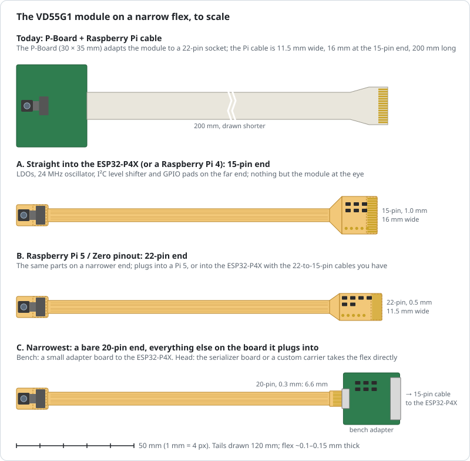

# Design sketch: the VD55G1 module on a narrow flex

Status: **design only, nothing built**. Items marked **VERIFY** need checking
before anything is ordered.

The goal is a camera shaped like the Raspberry Pi Zero mini cameras (for
example MELIFE's OV5647 "Zero V3.0"): a small head on a thin, narrow flex,
10–15 cm long. Today the ST CAM-5G1-080NIR promodule sits on ST's P-Board
(30 × 35 mm), and a Raspberry Pi 5 camera cable runs from it to the
ESP32-P4X board ([vd55g1-esp32p4.md](vd55g1-esp32p4.md)). That cable is
11.5 mm wide, 16 mm at its 15-pin end, and much thicker and stiffer than a Pi
Zero camera's flex.

## Why the cable is thick, and what fixes it

The Pi camera cables are **FFC** (flat flexible cable): flat copper strips
laminated in plastic, with a stiffener at each end to make the 0.3 mm the
sockets take. A Pi Zero mini camera's tail is usually an **FPC** (flexible printed
circuit): traces etched on thin polyimide, like a circuit board that bends.
An FPC can be only as wide as its traces need and is typically 0.1–0.15 mm
thick over its length.

No version of the sensor comes with a thinner cable. All three VD55G1
promodules (CAM-5G1-080NIR, -081CLR and -160CLR) end in the same 30-pin
Hirose BM28 plug, about 7.5 mm from the lens. The thick cable belongs to the
P-Board, which only adapts that plug to a Raspberry Pi socket. A flex that
takes the module's plug directly replaces both the P-Board and the cable.
ST's data brief also offers smaller modules "as a customized solution from
partner camera module integrators" (option D).

## What options A–C share

- **Head:** a polyimide pad about 13.5 × 9 mm carrying a Hirose
  **BM28B0.6-30DS/2-0.35V** receptacle, the mate of the module's
  BM28B0.6-30DP/2-0.35V plug (0.35 mm pitch, 0.6 mm mated height). Under it,
  a stiffener; beside it, one decoupling capacitor per supply. The lens points
  away from the tail. Height at the head: the module's 2.55 mm, the 0.6 mm
  connector, and the flex and stiffener, about 3.5 mm in all. **VERIFY** the
  receptacle's outline (about 7.9 × 1.7 mm, scaled from the 24-pin part) and
  which way the module's head points once mated, from Hirose's drawing.
- **Tail:** 2-layer polyimide, about 0.1–0.15 mm thick and 5.5 mm wide, 10–15
  cm long. Signals on the top layer, hatched ground on the bottom (hatched
  copper bends more easily than solid). Rolled-annealed copper, and no vias
  where it bends. About a quarter of a gram for 12 cm (estimate).
- **One MIPI lane** (the VD55G1 has only one): clock and data as two 100 Ω
  differential pairs, ground on each side. The lane runs at 250–1200 Mbit/s,
  or exactly 500 Mbit/s behind the serializer
  ([vd55g1-fpdlink.md](vd55g1-fpdlink.md)). Raspberry Pi cameras run CSI-2
  through 15–50 cm of plain FFC, so 10–15 cm is short. Ask the fab for
  impedance control on the flex; **VERIFY** it offers that on polyimide, and
  if not, keep the pairs tightly coupled and equal in length.

What the tail carries, about 18 conductors:

| Signal | Conductors | Notes |
|---|---|---|
| CLKP, CLKN | 2 | MIPI clock pair |
| DATA1P, DATA1N | 2 | MIPI data pair: the sensor's lane goes to the host's lane 0 |
| GND | 3 or more | Between and beside the pairs, plus the bottom layer |
| CLKIN | 1 | 6–27 MHz into the sensor (24 MHz on the bench, 25 MHz behind the serializer) |
| SCL, SDA | 2 | I²C at 1.8 V |
| XSHUTDOWN | 1 | Sensor reset, 1.8 V |
| GPIO0, GPIO1, GPIO2, GPIO3 | 4 | EXTSYNC in, STROBE out, FSYNC_OUT, spare: roles as in [vd55g1-esp32p4.md](vd55g1-esp32p4.md) |
| VANA_2V8, VDDIO_1V8, VCORE_1V15 | 3 | The module's supplies, made at the far end |

The module's 30-pin connector, from the spec sheet of the module's maker
(Chongqing Zhongshunwei's ZS1320-B, the same module: see option D). ST's
names are in brackets.

| Pin | Signal | Pin | Signal |
|---|---|---|---|
| 1 | AVDD 2.8 V (VANA_2V8) | 2 | GND |
| 3 | GND | 4 | DVDD 1.15 V (VCORE_1V15) |
| 5 | DOVDD 1.8 V (VDDIO_1V8) | 6 | RSTN (XSHUTDOWN) |
| 7 | GPIO-0 | 8 | GND |
| 9 | GPIO-1 | 10 | DP1 (DATA1P) |
| 11 | GPIO-2 | 12 | DN1 (DATA1N) |
| 13 | GPIO-3 | 14 | GND |
| 15 | NC | 16 | CKP (CLKP) |
| 17 | NC | 18 | CKN (CLKN) |
| 19 | NC | 20 | GND |
| 21 | NC | 22 | NC |
| 23 | GND | 24 | NC |
| 25 | SCL | 26 | GND |
| 27 | SDA | 28 | MCLK (CLKIN) |
| 29 | GND | 30 | GND |

The sensor's clock is an input on pin 28, so whatever board the flex plugs
into can drive it. **VERIFY** against ST's DB5267 figure 1 and the P-Board's
schematic before layout: the even pins agree with ST's figure as far as its
text could be read, but its odd pins 19–29 could not be matched with
certainty.

## Options

### A. Straight into the ESP32-P4X: 15-pin end

The far end is a 16 × 20 mm paddle with 15 gold contacts at 1.0 mm pitch, the
Raspberry Pi 4 layout that the ESP32-P4X's MIPI CSI socket (1.0K-GT-15PB)
carries. The paddle does the P-Board's job; the parts are the same kind
Espressif uses on the ESP32-P4X kit's own camera adapter:

- LDOs from the socket's 3.3 V to 2.8, 1.8 and 1.15 V (Espressif's adapter
  uses ME6211-series LDOs for 2.8 and 1.8 V). **VERIFY** what the P-Board
  uses for the 1.15 V core.
- A 24 MHz oscillator on the 1.8 V rail, for CLKIN.
- I²C level shifting between the socket's 3.3 V and the sensor's 1.8 V: a dual
  N-MOSFET with pull-ups on both sides, as on Espressif's adapter.
- XSHUTDOWN from the socket's CAM_IO0, as on the P-Board (the firmware drives
  CAM_IO0 high: [`firmware-p4/README.md`](../firmware-p4/README.md)).
- Solder pads for GPIO0–2, the 1.8 V rail and GND, wired to the bench's
  TXB0104 level shifter and LED driver exactly as the P-Board's are. The
  15-pin socket has no spare lines for them.

| Pi 15-pin | Signal | Pi 15-pin | Signal |
|---|---|---|---|
| 1 | GND | 9 | CAM_CK_P |
| 2 | CAM_D0_N | 10 | GND |
| 3 | CAM_D0_P | 11 | CAM_IO0 (→ XSHUTDOWN) |
| 4 | GND | 12 | CAM_IO1 (unused) |
| 5 | CAM_D1_N (unused) | 13 | SCL (3.3 V) |
| 6 | CAM_D1_P (unused) | 14 | SDA (3.3 V) |
| 7 | GND | 15 | 3.3 V |
| 8 | CAM_CK_N | | |

**VERIFY** this against the ESP32-P4X schematic, and which side its socket's
contacts face: the flex's gold contacts must face them. Espressif's guide
connects cameras with a "forward direction" cable, contacts on the same side
at both ends.

A also fits a Raspberry Pi 4 directly, and a Pi 5 through a 15-to-22-pin cable.

**Not behind the serializer as drawn.** In the 953's DVP mode the sensor must
run from the serializer's own clock ([vd55g1-fpdlink.md](vd55g1-fpdlink.md)),
so an oscillator on the paddle would fight it, which is the same problem the
P-Board has. If A or B is built anyway, fit the oscillator through a 0 Ω link
and bring CLKIN out to a pad, so a serializer board can feed it instead.

### B. Raspberry Pi 5 pinout: 22-pin end

The same paddle parts on an 11.5 × 22 mm end with 22 contacts at 0.5 mm pitch,
the Raspberry Pi 5 / Zero / Compute Module layout the P-Board's output already
uses. It plugs straight into a Pi 5 or Pi Zero. That's useful for bring-up,
since mainline Linux has a VD55G1 driver (`drivers/media/i2c/vd55g1.c`). It
reaches the ESP32-P4X through the 22-to-15-pin cables on hand. Pinout: Pi
22-pin, lane 0 on pins 2–3, clock on 8–9, CAM_IO0 on 17, SCL and SDA on 20 and
21, 3.3 V on 22; lanes 1–3 unused. **VERIFY** against the P-Board's output
before copying it.

### C. Narrowest: a bare 20-pin end

The tail simply ends in a 6.6 mm wide tab with 20 contacts at 0.3 mm pitch,
for a back-flip ZIF socket on whatever board serves the camera. All the
parts move off the flex, including the oscillator: CLKIN comes down the flex
from that board, which is what the serializer needs (its DVP mode runs the
sensor from the serializer's clock):

- **On the bench**, a small rigid adapter board (about 24 × 22 mm) carries the
  ZIF socket, the regulators, oscillator and level shifting from option A, and
  a 15-pin socket. One of the 22-to-15-pin cables on hand, or a 15-pin one,
  then runs to the ESP32-P4X. The adapter can also take the TXB0104 and LED
  driver that sit on the breadboard today.
- **On the head**, the same flex plugs into the serializer board of
  [vd55g1-fpdlink.md](vd55g1-fpdlink.md), the chosen design for freely moving
  animals. That board already has the supplies, the 25 MHz clock and 1.8 V
  I/O, so only the module and lens sit at the eye, and the serializer board
  can sit up to 15 cm away on the headstage. A custom ESP32-P4 carrier would
  take it the same way.

**VERIFY** the ZIF part, for example from Hirose's FH35C or FH26W series, and
the flex thickness it takes (often 0.2 mm, set with a stiffener under the
contacts).

### D. Option C, built into the module by its maker

The module's maker could make C in one piece: the VD55G1 head with the tail
running straight from it, as phone and Pi Zero camera modules are made. Then
there is no BM28 connector or pad at the eye, so the 5 × 5 mm sensor head is
the widest part.

- **The maker:** Chongqing Zhongshunwei Microelectronics. Its ZS1320-B
  drawing matches ST's CAM-5G1-080NIR exactly: 11.65 × 8.0 mm, a 5 × 5 mm
  head, 7.45 mm to the BM28 plug, a 940 nm filter. ST's partner page for the
  "VD55G1 Camera Module" lists clear, 650, 850 and 940 nm versions, and ST's
  data brief offers custom modules from partner integrators.
- **What to ask for:** C's far end and signals: a polyimide tail 10–15 cm long,
  6 mm wide or less and 0.15 mm thick or less, the MIPI pairs at 100 Ω, and 20
  fingers at 0.3 mm pitch. A 940 nm filter (850 nm as the alternative), and
  no oscillator at the head, since the serializer supplies MCLK.
- **The cost:** a custom part, so likely a setup (NRE) charge and a minimum
  order. A request is drafted, not yet sent.

## Comparison

| | A: 15-pin end | B: 22-pin end | C: bare 20-pin end | D: C, made by the module's maker |
|---|---|---|---|---|
| At the eye | module on a ~13.5 × 9 mm pad | same | same | the 5 × 5 mm head, no connector |
| Tail | 5.5 mm wide, ~0.1–0.15 mm | same | same | asked for: ≤ 6 mm, ≤ 0.15 mm |
| Far end | 16 mm paddle with parts | 11.5 mm paddle with parts | 6.6 mm tab, no parts | as C |
| ESP32-P4X | plugs in directly | through the 22-to-15 cables | through the adapter board | as C |
| Raspberry Pi | Pi 4; Pi 5 via 15-to-22 cable | Pi 5, Zero, CM directly | through the adapter, if it has a Pi socket | as C |
| Serializer head / custom carrier | no: its own oscillator (as the P-Board) | no: the same | plugs in directly; the serializer clocks the sensor | as C |
| Sensor clock (CLKIN) | oscillator on the paddle | oscillator on the paddle | from the board it plugs into | as C |
| Sync and strobe GPIOs | pads on the paddle | pads on the paddle | in the flex | as C |
| To make | one flex, assembled | one flex, assembled | a bare flex (one connector) + a small rigid board | the maker's NRE and minimum order, + the same rigid board |

## Recommendation

**C**, with the bench adapter. The freely moving rigs will use the serializer
head, and the cameras are being prototyped plugged into a serializer rather
than an ESP32-P4 board. C is the only flex that serves both the bench and
that head, and the only one that takes its clock from the board it plugs
into, as the serializer requires. It is also the simplest flex to make, with
one connector and no other parts. The adapter is an ordinary rigid board,
easy to change. Choose C's far-end connector to match the serializer
prototype's board, or put it on the adapter.

**The plan:** ask the module's maker to build C into the module (**D**), so the
sensor head is the widest part. If they decline, or it costs too much, make
C's flex ourselves with the standard module plugged into it. Either way the
far end, and the board it plugs into, are the same.

If one part that plugs straight into the ESP32-P4X matters more, **A**. Pick
**B** only if trying the camera on a Raspberry Pi 5 first matters.

## Before ordering (VERIFY)

1. Hirose's drawing for the BM28 receptacle: outline, footprint, and which
   way the module's head points once mated.
2. The module's 30 pin numbers (table above, from the ZS1320-B spec) against
   ST's DB5267 figure 1 and the P-Board's schematic.
3. A and B: the ESP32-P4X socket's pinout and contact side, and the P-Board's
   regulators and XSHUTDOWN circuit.
4. C: the 0.3 mm ZIF part and the flex thickness it takes.
5. The fab: polyimide thickness, stiffeners (polyimide or 0.2 mm FR4),
   impedance control on flex, and assembly on flex for the BM28.
6. The target: measure the Pi Zero camera's flex (width and thickness) next
   to these numbers.

## Sources

- ST CAM-55G1 promodule data brief DB5267 rev 2 (variants, BM28 connector,
  pinout, dimensions, the partner-integrator offer)
- ST STEVAL-CAM-M0I (P-Board) data brief
- Chongqing Zhongshunwei ZS1320-B (VD55G1CCB0) camera module specification,
  2023-12-06 (drawing, pinout, BM28 connector, filter), hosted by Future
  Electronics
- ST partner products: "VD55G1 Camera Module" (filter options)
- Espressif ESP32-P4X-Function-EV-Board user guide (MIPI CSI socket
  1.0K-GT-15PB: 1.0 mm pitch, 0.3 mm FPC) and its camera adapter board
  schematic (LDOs, oscillator, I²C level shifting)
- Hirose BM28 series (distributor listings: 0.35 mm pitch, 0.6 mm height;
  24-pin receptacle 6.8 × 1.7 mm)
